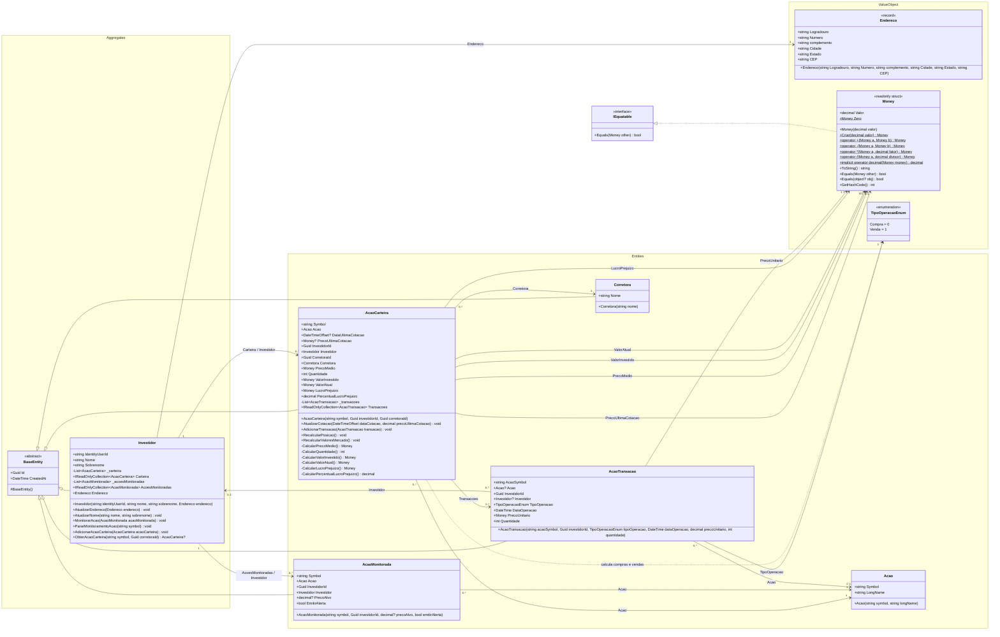

# CarteiraInvest

Sistema fullstack de gerenciamento e acompanhamento de carteira de investimentos.
O projeto contará com uma API para atender o front feito em Angular e fará integração com API da Brapi para consultar 
os symbols, nome dado aos códigos das ações pela API externa.
Contara com cache Redis, PostgreSQL para armazenar informacoes das carteiras e IdentityDB para servir de base de dados para armazenar os dados de usuários.
[Link para documentação no miro:](https://miro.com/app/board/uXjVEYtcPi0=/?share_link_id=678945879539)

## 🛠️ Tecnologias Utilizadas

- **Frontend:** Angular (SPA com SCSS)
- **Backend:** .NET 10 Web API
- **Banco de Dados:** PostgreSQL
- **Cache:** Redis
- **Infraestrutura:** Docker, Docker Compose e Nginx
- **Hospedagem:** VM Linux

## 📁 Estrutura do Projeto

```text
PrjCarteiraInvest/
├── app/          # API Backend em .NET
├── deploy/       # Docker Compose e configurações de Nginx
├── front/        # Aplicação Frontend Angular
└── testes/       # Testes automatizados
```

## 📁 Estrutura de app (onde fica a API em .Net)

```text
app/
└── src/
    └── CarteiraInvest/
        ├── CarteiraInvest.Api/
        ├── CarteiraInvest.Application/
        ├── CarteiraInvest.Domain/
        ├── CarteiraInvest.Infra/
        └── CarteiraInvest.slnx
```

## Diagrama UML de Domain

# Diagrama UML — CarteiraInvest.Domain

Diagrama baseado nos 10 tipos declarados em `app/src/CarteiraInvest/CarteiraInvest.Domain`, nas pastas `Aggregates`, `Entities` e `ValueObject` (nome usado no código).

## Classes e relacionamentos



## Convenções

- `+`: público; `-`: privado; `#`: protegido; `$`: membro estático.
- `?`: tipo anulável; `0..1`: referência opcional; `0..*`: coleção que pode estar vazia.
- Triângulo com linha contínua: herança; triângulo com linha tracejada: implementação de interface; seta contínua: associação; seta tracejada: dependência.
- As propriedades mostram a visibilidade de leitura. Os setters são privados, exceto `BaseEntity.Id` e `CreatedAt`, que possuem setters protegidos. `Money.Valor` possui somente getter; `Endereco` é um record posicional com propriedades `init` geradas pelo compilador.
- Os relacionamentos representam propriedades e coleções declaradas no código. Não pressupõem configuração de banco de dados, exclusão em cascata ou composição exclusiva. A interface `IEquatable<Money>` pertence ao .NET e aparece apenas para mostrar sua implementação.
- Construtores e membros explicitamente declarados foram incluídos; membros gerados pelo compilador para o record e membros herdados de `object` não são repetidos.


